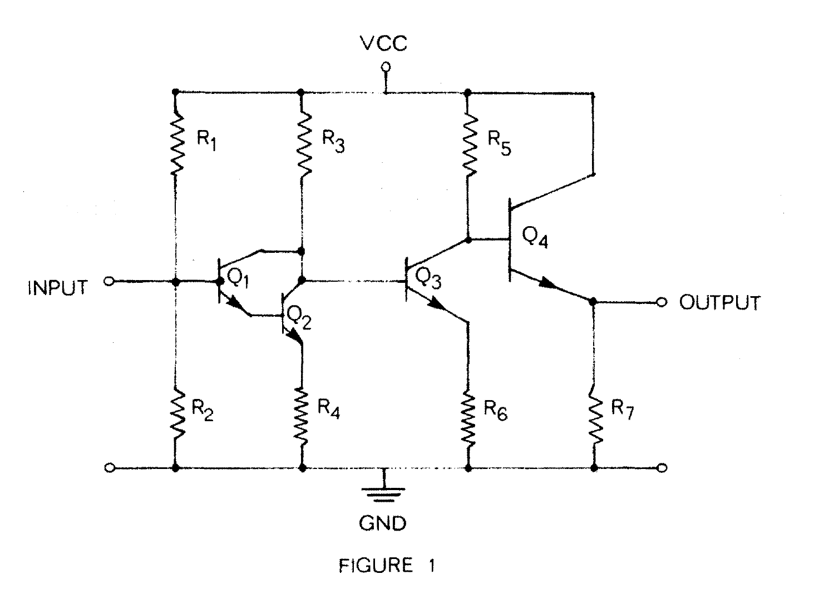
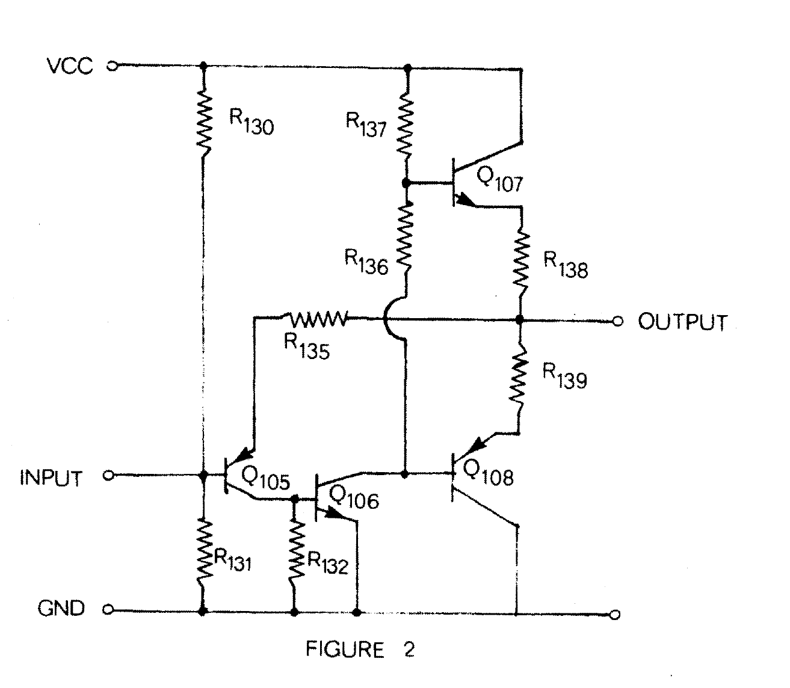
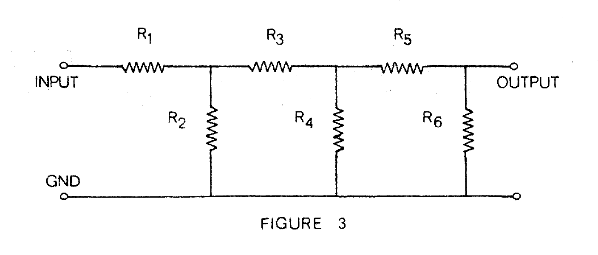
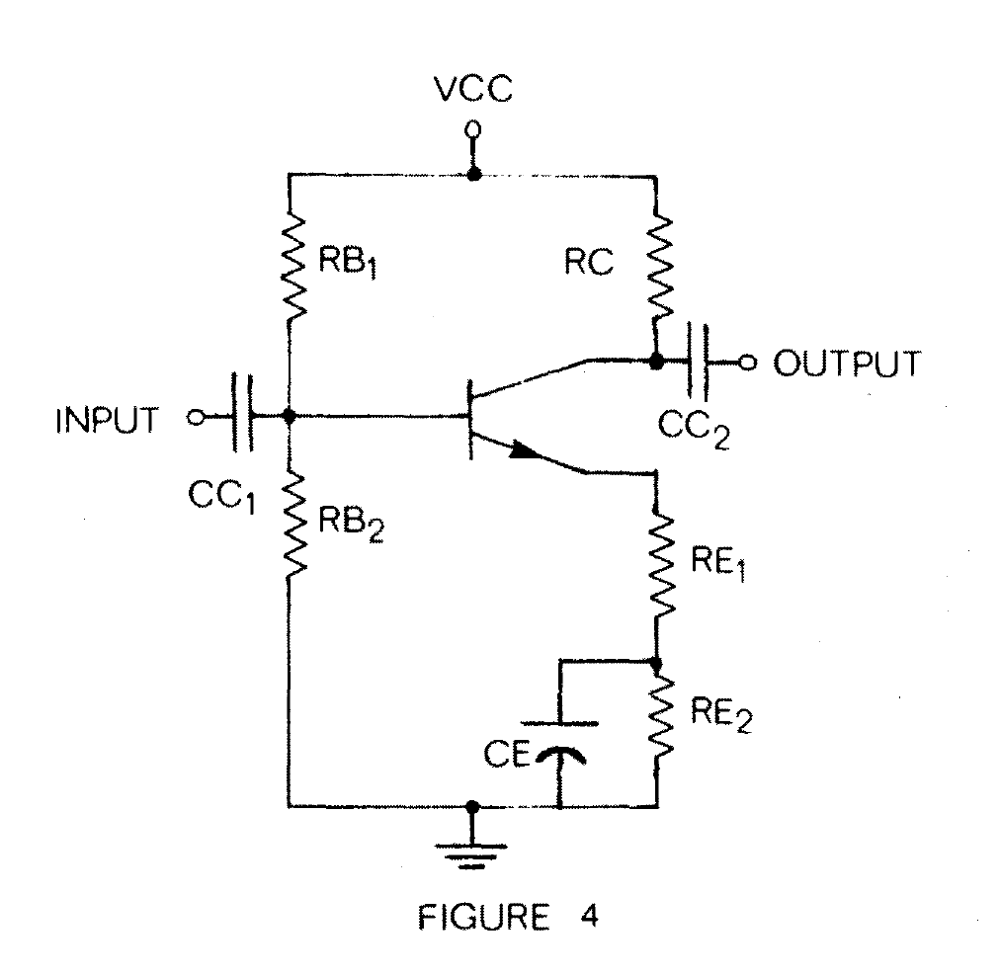
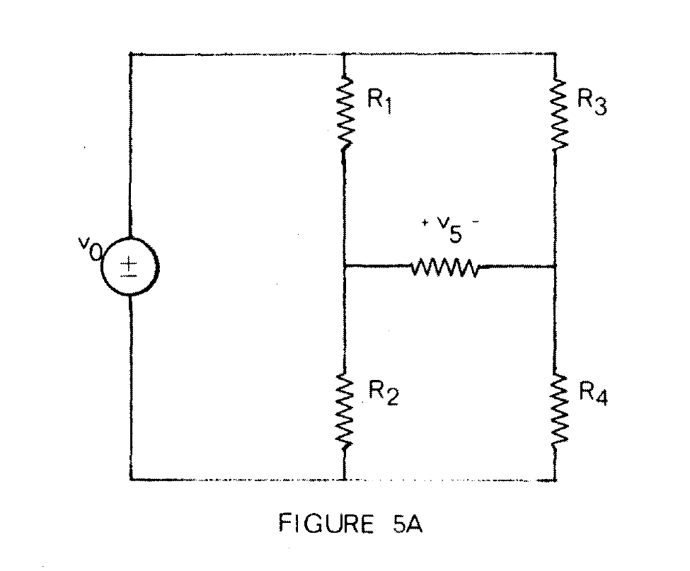
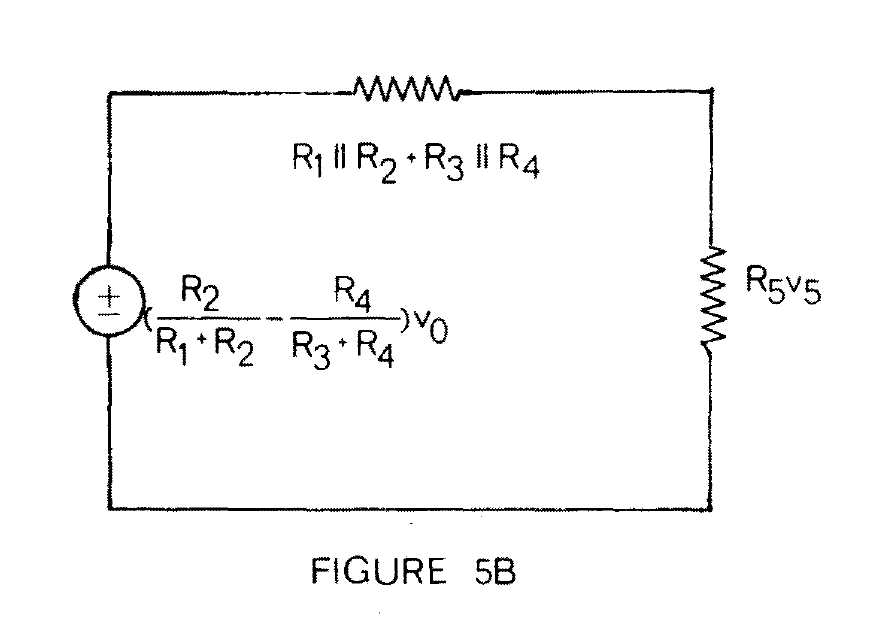
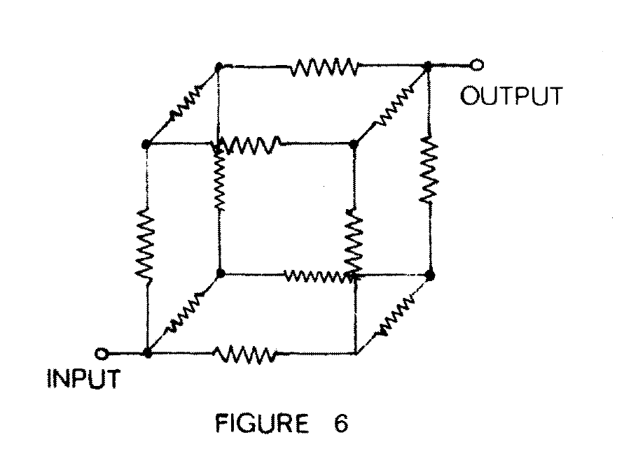

MASSACHUSETTS INSTITUTE OF TECHNOLOGY
ARTIFICIAL INTELLIGENCE LABORATORY

Memo No. 328 — March 1975

# Heuristic Techniques in Computer Aided Circuit Analysis

by Gerald Jay Sussman and Richard Matthew Stallman

## Abstract

We present EL, a new kind of circuit analysis program. Whereas other circuit analysis systems rely on classical, formal analysis techniques, EL employs heuristic "inspection" methods to solve rather complex DC bias circuits. These techniques also give EL the ability to explain any result in terms of its own qualitative reasoning processes. EL's reasoning is based on the concept of a "local one-step deduction" augmented by various "teleological" principles and by the concept of a "macro-element". We present several annotated examples of EL in operation and an explanation of how it works. We also show how EL can be extended in several directions, including sinusoidal steady state analysis. Finally, we touch on possible implications for engineering education. We feel that EL is significant not only as a novel approach to circuit analysis but also as an application of Artificial Intelligence techniques to a new and interesting domain.

Work reported herein was conducted at the Artificial Intelligence Laboratory, a Massachusetts Institute of Technology research program supported in part by the Advanced Research Projects Agency of the Department of Defence and monitored by the Office of Naval Research under contract number N00014-70-A-0362-0005.

## Introduction

Every engineering student is taught "formal" methods for analyzing electrical networks. The practicing engineer quickly discovers that he hardly ever uses those methods. He finds himself solving most problems by "inspection" techniques. These inspection methods are said to be "informal" and to spring from the mysterious land of "experience". In an effort to formalize these intuitive notions we have written EL, a new kind of electrical network analysis program [1]. The literature is replete with powerful and useful circuit analysis systems [2] which implement the formal methods. What is novel about this program is its heuristic approach to network analysis and its consequent ability to *explain* the basis of its deductions. Although the current version of EL can only handle DC bias analysis, with a rather crude transistor model at that, the approach leads quickly to rather impressive results.

The best way to understand EL is to follow it out on some examples. We first present several example conversations with EL. We have annotated the examples to extract the reasoning used. Then we give a general discussion of the techniques employed to implement the results illustrated. Finally, we discuss the possible extensions and ultimate limitations of these techniques. We also touch on possible implications for education. In the text that follows the Gothic font will be used to indicate interactions with the computer -- lower case is typed by the user, upper case by the computer. The commentary is in the Roman font.

## Example 1

Let us first consider a simple four transistor amplifier circuit [3] with no multistage feedback (See Figure 1.). We see that this is a direct-coupled amplifier. Its input is a common-emitter Darlington pair, followed by a simple common-emitter amplifier, followed by an emitter-follower output circuit. We encode this wiring diagram for EL as follows:

```
(wire 4t-amp
 (node (vcc 15) (gnd 0) input output)
 (transistor (q1 .6) (q2 .6) (q3 .6) (q4 .6))
 (resistor (r1 370000) (r2 100000) (r3 10000) (r4 1800)
           (r5 5600) (r6 3900) (r7 6800))
 (connect
  (vcc (#1 r1) (#1 r3) (#1 r5) (c q4))
  (gnd (#2 r2) (#2 r4) (#2 r6) (#2 r7))
  (input (#2 r1) (#1 r2) (b q1))
  ((#2 r3) (c q1) (c q2) (b q3))          ;NODE1
  ((e q1) (b q2))                         ;NODE2
  ((e q2) (#1 r4))                        ;NODE3
  ((#2 r5) (c q3) (b q4))                 ;NODE4
  ((e q3) (#1 r6))                        ;NODE5
  (output (e q4) (#1 r7)))
 (hint (vd r1 r2)))

DONE
```

I hope that this method of specifying the wiring diagram is pretty clear. The diagram gets a name, 4T-AMP. Next, the named nodes are declared; in this case there are only four of them -- VCC, GND, INPUT, and OUTPUT. There are other nodes in the network but they are not given names by the user. EL chooses names for them. We have indicated EL's names by "comments" beginning with semicolons. Notice that two of the named nodes are given default fixed voltages; the others are left with unknown voltages. Four silicon, NPN transistors are declared -- they have a default base-emitter voltage of .6 volt. PNP transistors would have negative base-emitter voltages, and germanium transistors would have voltage drops of magnitude .3. Seven resistors are similarly declared with their resistance values in ohms. Then, all connections are made. Each component has certain terminals -- a resistor has a #1 and a #2, a transistor has a B, E, and C. Each expression in the CONNECT clause is the set of terminals which are identified to make up a single node. This section is used to assign the previously declared names of the named nodes to particular connections. Finally, the encoded wiring diagram contains a section for the declaration of certain hints which are necessary for the proper operation of the analysis program. In this case we see that R1 and R2 are declared to together constitute a voltage divider. The reason for the necessity of such *teleological* hints will be discussed later [4].

After the wiring diagram is specified the we ask EL to perform the analysis:

```
(analyze '4t-amp)

(Q1 CURRENT E 0.0)
(INPUT VOLTAGE V7)
(R1 CURRENT ME (&+ 4.0540541E-5 (&* -2.7027027E-6 V7)))
(R2 CURRENT #1 (&+ 4.0540541E-5 (&* -2.7027027E-6 V7)))
(V7 VARVAL 3.19148964)
(NODE2 VOLTAGE 2.59148955)
(NODE3 VOLTAGE 1.99148953)
(R4 CURRENT ME 1.10638307E-3)
(Q2 CURRENT E -1.10638307E-3)
(R3 CURRENT #2 -1.10638304E-3)
(NODE1 VOLTAGE 3.9361696)
(NODE5 VOLTAGE 3.3361697)
(R6 CURRENT ME 8.55428135E-4)
(Q3 CURRENT E -8.55428135E-4)
(R5 CURRENT #2 -8.5542817E-4)
(NODE4 VOLTAGE 10.2096023)
(OUTPUT VOLTAGE 9.609602)
(R7 CURRENT ME 1.41317676E-3)
(Q4 CURRENT E -1.41317676E-3)
DONE
```

Now let's examine how the analysis proceeds. First, EL *notices* that the current into the emitter of Q1 is 0.0 amperes. Of course, this is false; but it is very nearly true -- it is based on the assumption that the base current of a transistor is likely to be insignificant. This is not an assumption about the *intrinsic* properties of the transistor but rather on its *extrinsic* properties -- how people use transistors in design. Such teleological assumptions are the source of much of the power, and most of the limitations of EL. Next, EL concentrates on the input voltage divider. An abstract voltage unknown, V7, is assumed at the center of the divider. This makes it possible to compute an expression for the current through R1. Since no current goes into the base of transistor Q1 (ha, ha!) EL deduces that all of the current coming out of R1 goes into R2. But then, Ohm's law is applied at R2 to get the voltage on the INPUT node. The resulting expression is set equal to V7. This equation has only one unknown -- it is easy to solve -- thus EL finds a value for V7. Now, NODE2 is the second anonymous node in the wiring diagram -- where the emitter of Q1 connects to the base of Q2. EL makes the assumption that transistors are run in their active region unless otherwise hinted -- another teleological assumption. Thus, the base-emitter drop of Q1 is assumed to be the nominal .6 volts so NODE2 is assigned a voltage .6 volts less than V7. NODE3 is at the emitter of Q2. It is assigned a voltage in a similar manner. This makes it possible to calculate the current through R4. This current must all go through the transistor, Q2, and come out of its collector. It then finds its way into R3 (since none goes into the base of Q3 and EL has already deduced that Q1's current is 0.0). This allows EL to deduce the voltage at node NODE1 (Q2's collector).

We could continue to explain these deductions, ad nauseum. We would see that they all -- except for the assumption of an unknown voltage at the center of the voltage divider -- have an essentially local flavor [5]. Each network element or node is a little process attempting to assign any network unknown that can be deduced locally from knowns -- but more about the implementation later. EL is very conscious about how it makes its deductions. As it makes them it takes notes on the process. Thus we can ask it to justify the claim that it knows, say, the value of the current through R3:

```
(why r3 current)

((R3 CURRENT) <= ((Q3 CURRENT B) (Q2 CURRENT C) (Q1 CURRENT C)) - KCL)
((Q3 CURRENT B) GIVEN)
((Q2 CURRENT C) <= ((R4 CURRENT #1)) - KCL)
((Q1 CURRENT C) <= ((Q2 CURRENT B)) - KCL)
((R4 CURRENT #1) <= ((NODE3 VOLTAGE) (GND VOLTAGE) (R4 RESISTANCE)) - OHM)
((Q2 CURRENT B) GIVEN)
((NODE3 VOLTAGE) <= ((Q2 VBE) (NODE2 VOLTAGE)) - BE)
((R4 RESISTANCE) GIVEN)
((Q2 VBE) GIVEN)
((NODE2 VOLTAGE) <= ((Q1 VBE) (INPUT VOLTAGE) (V7 VARVAL)) - BE)
((Q1 VBE) GIVEN)
((V7 VARVAL) <= ((INPUT VOLTAGE) (GND VOLTAGE)
                 (R2 CURRENT #1) (R2 RESISTANCE)) - OHM)
((R2 CURRENT #1) <= ((Q1 CURRENT B) (R1 CURRENT #2)) - KCL)
((Q1 CURRENT B) GIVEN)
((R1 CURRENT #2) <= ((VCC VOLTAGE) (INPUT VOLTAGE) (R1 RESISTANCE)) - OHM)
((INPUT VOLTAGE) <= ((R1 RESISTANCE) (R2 RESISTANCE)
                     (VCC VOLTAGE) (GND VOLTAGE)) - VD-DEMON)
((R1 RESISTANCE) GIVEN)
((VCC VOLTAGE) GIVEN)
((R2 RESISTANCE) GIVEN)
((GND VOLTAGE) GIVEN)
          QED
```

Here we see the "proof" that the current indicated can be deduced from elementary assumptions. Each line of the proof is the justification of the deduction of the first quantity named in that line. The list after the arrow is the quantities on which the deduction was based. The last element of the line is the "law" by which the deduction was made. Besides such familiar laws as KVL, KCL, and OHM, there are some other, less familiar ones as BE, governing base-emitter voltages of transistors, and VD-DEMON, which mediates the hint about voltage-dividers. Note that the line beginning "INPUT VOLTAGE" represents the decision to introduce a symbolic variable ("V7", in this instance) to represent the voltage at the node named INPUT. The reasons given are the facts that show that the node INPUT is in the middle of a voltage divider. The line beginning "V7 VARVAL" represents the actual determination of the value of V7, with the bases being all the quantities entering into the equation which was used to solve for V7.

EL remembers not only how it arrived at each fact it knows, but also all the ways each fact was used in deductions. Thus, we can ask EL to forget the assumed value of one of the initially given quantities, and also all conclusions depending on that assumption. Here, we tell EL to try a new value for the resistance of R6:

```
(change r6 resistance 3200.0)

(R6 RESISTANCE 3200.0)
(R6 CURRENT ME 1.04255303E-3)
(Q3 CURRENT E -1.04255303E-3)
(R5 CURRENT #2 -1.042553E-3)
(NODE4 VOLTAGE 9.161703)
(OUTPUT VOLTAGE 8.56170272)
(R7 CURRENT ME 1.25907393E-3)
(Q4 CURRENT E -1.25907393E-3)
DONE
```

EL first forgot the initially assumed value of R6's resistance and all deduced quantities depending on it. Then, EL made the new assumption about the resistance of R6, and proceded to make all possible deductions from that assumption, along with those previous conclusions that it had not been necessary to forget, using the same mechanism as before. All of the forgotten quantities were rededuced, but with appropriately different values.

## Example 2

This circuit (See Figure 2.) describes another direct-coupled amplifier [6]. Here we see two new sources of complexity. There is a multistage feedback loop and a complementary pair. We introduce this example because the previous example might give you the false impression that EL's local deductive scheme gives rise to an overall reasoning which is causal in nature. Causal reasoning often causes difficulty in analysis of systems with feedback because of instabilities in relaxation. The kind of reasoning done by EL, however, gets the answer without relaxation.

Let us first understand how this circuit is *supposed to work* -- we look at the real causality. In this circuit Q107 and Q108 form a complementary pair which is supposed to hold the node labeled OUTPUT at a voltage just somewhat higher than the voltage on the node labeled INPUT. If the output voltage is higher than it ought to be, Q105 conducts more than it ought to. This means more current enters the base of Q106, causing it to conduct more, pulling down the bases of Q107 and Q108, and thus restoring the output node to its correct voltage. This is the negative feedback path. Now let's see what EL does with this circuit -- first we must give it the wiring diagram:

```
(wire gr-58
 (node (vcc 25.0) (gnd 0) input output)
 (resistor (r130 180000) (r131 120000) (r132 2700)
           (r135 4700) (r136 150) (r137 1800)
           (r138 2.7) (r139 2.7))
 (transistor (q105 -.6) (q106 .6) (q107 .6) (q108 -.6))
 (connect
  (vcc (#1 r130) (#1 r137) (c q107))
  (input (#2 r130) (b q105) (#1 r131))
  ((#1 r132) (c q105) (b q106))                    ;NODE1
  ((e q105) (#2 r135))                             ;NODE2
  (gnd (#2 r131) (#2 r132) (e q106) (c q108))
  ((c q106) (b q108) (#2 r136))                    ;NODE3
  ((#1 r136) (b q107) (#2 r137))                   ;NODE4
  ((e q107) (#1 r138))                             ;NODE5
  (output (#2 r138) (#1 r135) (#1 r139))
  ((#2 r139) (e q108)))                            ;NODE6
 (hint (vd r130 r131) (cp q107 q108)) )

DONE
```

One new type of hint appears here: (CP Q107 Q108). It tells EL to regard Q107 and Q108 as a complementary pair -- more about this later. Let's now examine the analysis of this circuit:

```
(analyze 'gr-58)

(NODE1 VOLTAGE 0.60000002)
(R132 CURRENT ME 2.2222223E-4)
(Q105 CURRENT C -2.22222224E-4)
(R135 CURRENT #2 -2.22222224E-4)
(INPUT VOLTAGE V9)
(R130 CURRENT ME (&+ 1.38888892E-4 (&* -5.5555556E-6 V9)))
(R131 CURRENT #1 (&+ 1.38888892E-4 (&* -5.5555556E-6 V9)))
(V9 VARVAL 10.000001)
(NODE2 VOLTAGE 10.6000013)
(OUTPUT VOLTAGE 11.6444454)
```

Let me interrupt the output stream here to insert an observation: EL has determined the voltage on the output node without making any deductions about the properties of transistors Q107 or Q108 -- but it is these transistors which actually *cause* the output node to have that particular voltage! It seems that the teleological assumptions about Q105 and Q106 -- the assumptions that the designer intended that they run in their active regions -- is sufficient to "force" the voltage on the output node to be determined. With this information in hand EL goes on to deduce other properties of the circuit -- in particular, the approximate voltages on the bases of Q107 and Q108:

```
(NODE4 VOLTAGE (&+ 11.6444454 V10))
(R137 CURRENT ME (&+ 7.4197524E-3 (&* -5.5555555E-4 V10)))
(R136 CURRENT #1 (&+ 7.4197524E-3 (&* -5.5555555E-4 V10)))
(Q106 CURRENT C (&+ 7.4197524E-3 (&* -5.5555555E-4 V10)))
(NODE3 VOLTAGE (&+ 10.5314827 (&* 1.08333337 V10)))
(V10 VARVAL 0.53422212)

DONE
```

Notice how, as soon as the voltage at the node OUTPUT has been determined, EL assumes values for the voltages at the bases of the transistors involved: at NODE3 the voltage assumed is 11.64+V10, while that at NODE4, the other transistor's base, it is 11.64-V10. The complementary pair declaration created a demon which embodies the assumption that the voltages on the transistor bases are symmetrical around the midpoint of the pair -- in this case, the node OUTPUT. If one of those three voltages receives a value, the other two will be given values in terms of it and a symbolic variable made for the occasion. Thus, if one base voltage were given the value 10, the OUTPUT voltage would receive the value 10-X; the other base, the value 10-2X. The value of X could be determined if the two unknown voltages were related in any other way. In this case the network of resistors around NODE3 and NODE4, leads to an independent determination of the voltage at NODE4 (10.53+1.083*V10) which, together with the complemetary pair assumption of 11.64-V10, allows V10 to be determined. The complementary-pair hint also tells EL that the transistors may be cut off, so their base-emitter voltages should not be assumed to be the usual .6 or .3 volts. As in the previous example, we can ask EL how it arrived at any of its conclusions:

```
(why output voltage)

((OUTPUT VOLTAGE) <= ((NODE2 VOLTAGE) (R135 CURRENT #2)
                      (R135 RESISTANCE)) - OHM)
((NODE2 VOLTAGE) <= ((Q105 VBE) (INPUT VOLTAGE) (V9 VARVAL)) - BE)
((R135 CURRENT #2) <= ((Q105 CURRENT E)) - KCL)
((R135 RESISTANCE) GIVEN)
((Q105 VBE) GIVEN)
((V9 VARVAL) <= ((INPUT VOLTAGE) (GND VOLTAGE)
                 (R131 CURRENT #1) (R131 RESISTANCE)) - OHM)
((Q105 CURRENT E) <= ((Q106 CURRENT B) (R132 CURRENT #1)) - KCL)
((R131 CURRENT #1) <= ((Q105 CURRENT B) (R130 CURRENT #2)) - KCL)
((Q106 CURRENT B) GIVEN)
((R132 CURRENT #1) <= ((NODE1 VOLTAGE) (GND VOLTAGE)
                       (R132 RESISTANCE)) - OHM)
((Q105 CURRENT B) GIVEN)
((R130 CURRENT #2) <= ((VCC VOLTAGE) (INPUT VOLTAGE)
                       (R130 RESISTANCE)) - OHM)
((INPUT VOLTAGE) <= ((R130 RESISTANCE) (R131 RESISTANCE)
                     (VCC VOLTAGE) (GND VOLTAGE)) - VD-DEMON)
((R130 RESISTANCE) GIVEN)
((VCC VOLTAGE) GIVEN)
((R131 RESISTANCE) GIVEN)
((NODE1 VOLTAGE) <= ((Q106 VBE) (GND VOLTAGE)) - BE)
((GND VOLTAGE) GIVEN)
((R132 RESISTANCE) GIVEN)
((Q106 VBE) GIVEN)
        QED
```

## Example 3

In this example (See Figure 3.) we show how the local one-step deductions of EL handle a classical problem of network analysis -- the ladder network. This network is the basis of many important filter networks -- we will come back to this again when we talk about frequency domain analysis. As usual, we must first give EL the wiring diagram:

```
(wire ladder
  (node (gnd 0.0) (input 1.0) output)
  (resistor (r1 1) (r2 2) (r3 1) (r4 2) (r5 1) (r6 1))
  (connect
      (gnd (#2 r2) (#2 r4) (#2 r6))
      (input (#1 r1))
      ((#2 r1) (#1 r2) (#1 r3))          ;NODE1
      ((#2 r3) (#1 r4) (#1 r5))          ;NODE2
      (output (#2 r5) (#1 r6))))

DONE
```

We next ask EL to analyze the network:

```
(analyze 'ladder)

DONE
```

Nothing happened! There are no immediate one-step deductions that can be made. No resistor has three out of four of its parameters defined and no node has all except one of its branch currents defined. Does this mean that EL finds the problem hopeless? We have never told EL just what we were after -- let's ask for the voltage on the node labelled OUTPUT:

```
(what output voltage)

(OUTPUT VOLTAGE V3)
(R6 CURRENT ME V3)
(R5 CURRENT #2 (&* -1.0 V3))
(NODE2 VOLTAGE (&* 2.0 V3))
(R4 CURRENT ME V3)
(R3 CURRENT #2 (&* -2.0 V3))
(NODE1 VOLTAGE (&* 4.0 V3))
(R1 CURRENT ME (&+ 1.0 (&* -4.0 V3)))
(R2 CURRENT #1 (&+ 1.0 (&* -6.0 V3)))
(V3 VARVAL 0.125)

0.125
```

We seem to have gotten the answer -- the output voltage is 1/8 volt. EL used an old trick [7] which might be called "wishful thinking". EL looked for the answer and determined that it was unknown. It then assumed that it knew the answer -- it postulated a formal variable for the answer. The consequences of this assumption were then worked out. In particular, if the output voltage is known then we get a value for the current through R6. This same current goes through R5, giving us the voltage at the other side of R5 (NODE2). We can now get the current through R4 since we know the voltage at each of its terminals. KCL now gives us the current through R3. We use the current through R3 to get the voltage at the top of R2 (NODE1). This makes it possible to deduce the current through R1 by Ohm's law. KCL is then applied at NODE1 getting the current through R2. Happily, the voltage is known at both sides of R2. This application of Ohm's law as a consistency check results in an equation in one unknown -- the original assumed voltage -- to solve.

## How EL works

Now that we see what EL can do it is time to examine how it works. We feel that the ideas behind the implementation elucidate various fundamental problem solving notions. By now you probably realize that one essential ingredient in EL is the idea of a "local one-step deduction". Inside of EL each conceptual object in the electrical network under consideration (eg. a resistor, transistor, or node) is modelled as a data structure with various "slots" which can be "filled" with data. Each of these structures also has a TYPE which specifies what "laws" apply to that structure. A law, Ohm's law for example, is a set of procedures relating the resistor's slots for its resistance, the voltages at the two nodes attached to its terminals, and its branch current, so that if all except one of the slots is filled the last can be filled. Each instance of resistor, node, or other object which is part of a circuit wiring diagram knows what other parts it is connected to and thus, what other parts would be interested if one of its slots becomes filled by the application of a law. When such an event takes place, the relevant other parts are awakened so that their laws may be applied to the situation. Thus, a new piece of information may be locally deduced in one place in the network but consequences of this deduction may propagate from element to element all over the network. Because of the strong connectedness of electrical networks it is often the case that an element is awakened by the filling of its last slot by a neighbor. In this situation a law may not be used to deduce anything new but it is applied to check the consistency of the assumptions which have been made. Such a consistency check may, however, result in a deduction -- ie. the assignment of a value to a formal unknown (as we shall see).

Of course, local one-step deductions are not sufficient to solve most, or even many, networks of interest. It is sometimes necessary to take a somewhat more global view. Consider, for example, the situation of two resistors in series, as in a voltage divider. Although the voltage may be known at both ends of the divider there is no one-step deduction which will get the answer at the center. The problem is that neither resistor has enough information to fill a slot. Each resistor has one terminal voltage and its own resistance filled but both the current through it and the voltage at the midpoint node are still unknown. The essence of why the situation is solvable, however, is the more global assertions that "Whatever current goes through one resistor goes through the other." and "The voltage at the top of the bottom resistor is the same as the voltage at the bottom of the top resistor." -- the simultaneous constraints. Just how can we handle this kind of situation? The answer is hidden in our description of the situation! We described the situation in terms of the concept of a voltage divider. A voltage divider is a composite element with three terminals made up of simpler elements working together to achieve the *purpose* of producing a particular voltage at its midpoint. The hint declaration compiles into a demon -- actually a macro-element -- whose law senses the voltage slots of the top and bottom nodes of the voltage divider. If they are filled it assigns a newly generated symbol of TYPE VARIABLE to the voltage slot of the midpoint of the divider. One resistor is awakened, assigning the current through it in terms of this abstract potential. KCL at the midpoint then assigns this current to the other resistor which then awakens to run a consistency check. In testing the equality EL discovers that there is an unassigned variable in the equation under test. The equation is then solved and the variable assigned. The voltage divider demon uses the abstract variable manipulation system rather than assigning the voltage at the midpoint itself (from the voltage divider formula, which it could know) so that the voltage can be correctly determined even if there is a significant current withdrawn from the midpoint. The concept of a macro-element is independent of the concept of an abstract formal unknown.

Is this just an ad hoc method? -- or is there something more fundamental here worthy of consideration? We believe the latter, the concept of a macro-element with a teleology is essential to solving hard problems if we are not to get bogged down in details. In support of this idea is the fact that human circuit designers constantly use such macro components as op-amps, and-gates and flip-flops. The complementary pair macro of Example 2 is a good example where we see that the characteristics of the compound element are not trivially deducible from the elementary characteristics of its parts. The hint demon mechanism is a start at building a hierarchy of higher order plan fragments and other teleological commentary to direct the process of hypothesis formation in reasoning about such causal systems. It is one method of transforming a global deductive process into a local one which can be handled by one-step deductions in an efficient way.

## Extensions

We see several directions in which EL can be extended. We can give it more knowledge of electricity and we can try to give it even more powerful problem-solving capabilities. As it stands, EL knows nothing about signals, inductors or capacitors -- only DC bias analysis. Thus, a logical place to begin to discuss extensions is to examine what it would take to make EL capable of incremental analysis.

Let us first consider the circuit of Figure 4. This is a standard capacitance-coupled common-emitter amplifier. Just what kinds of new features would EL need to be able to give an account of the signal as well as the DC bias? Suppose that we augment EL as follows: For each current or voltage slot in the old program let there be a pair of slots -- the DC component and the incremental component. We process the DC component as before, with the exception that we must make up a new law for capacitors: The DC component of the current through a capacitor is always zero. Now what kinds of rules must the incremental component obey? At fixed nodes, such as VCC and GND, the incremental voltage is always zero. In this circuit the only purposes capacitors have are COUPLING and BYPASS. These capacitors have been picked by the designer so that their reactances at the signal frequencies of interest are negligible (to first approximation). Thus, each capacitor so marked (by a hint), is incrementally a short circuit -- the incremental voltages at its terminals must be the same. So, let's assume an incremental voltage, V, is applied to the input node. This is then propagated to the center of the bias voltage divider. Ohm's law is the same for incremental voltages and currents as it is for bias voltages and currents -- thus we know the incremental currents in the voltage divider resistors. Now, one reasonable approximation for the incremental behavior of a transistor, running in its active region, is that the incremental voltage on the base is reflected in incremental voltage on the emitter (This is pretty good in this case but we will see how it can lose.) but the incremental emitter current shows up as incremental collector current. Thus the incremental voltage V appears on the emitter. But the bypass capacitor insures that the incremental voltage at the bottom of RE1 is zero. Thus the incremental current through RE1 can be calculated by Ohm's law to be V/RE1. This incremental current goes through the collector-emitter circuit of the transistor and through the collector resistor RC. But then Ohm's law can be applied here giving us the incremental voltage at the collector as -V*RC/RE1. This voltage is then conveyed to the output by the coupling capacitor. Note that we have just computed the incremental gain of the amplifier (assuming that the beta of the transistor is very large). So incremental analysis is easy when we don't really care about the frequency of the signal -- if the components in question are only for coupling or bypass. If, however, we are confronted with capacitors and inductors whose purposes indicate that they are present to shape the frequency response of the system to be analyzed then we need to do a more detailed analysis. Sinusoidal steady state analysis is not really much harder than incremental analysis -- the only difference is that the slots may have to contain complex quantities that depend upon frequency rather than real numbers. One may consider a capacitor or inductor to be a resistor with a complex-valued resistance, for example.

The transistor rule just expounded is rather simplistic so we will often need a more complex model to save the day. Consider, for example, the case of the circuit of Figure 3 with RE1=0, a common configuration -- no negative feedback in the signal path. In this case the emitter is constrained to be at zero incremental voltage. Thus, the transistor has a non-zero base-emitter incremental voltage! In this case we must consider the actual transconductance of the transistor to find the incremental collector (emitter) current. Even in the case of DC bias analysis the approximations made by EL can be too inaccurate. For example, it is often important that the beta of a transistor is finite -- the base current is not really zero. This bias current may affect the base bias voltage. In Figure 4, for example, the base bias current may significantly load the voltage divider (RB1, RB2), changing the value that the simple model predicts for the emitter voltage. One idea for improving the approximation, which seems to be the way engineers we have observed do it, is a kind of perturbation analysis. Suppose the approximate emitter current is deduced, say by deducing the approximate emitter voltage from the base voltage as set by the voltage divider, under the assumption that the base current is zero, and then applying Ohm's law to the emitter resistor. This emitter current can be used to get an approximate value of the base current given some value of the beta of the transistor. By CHANGEing the base current to the new approximate value, EL will then calculate a new value for the base voltage. If this new base voltage is not significantly different from the previous approximation we are done. Otherwise, this value is accepted and shoved through the transistor to get a new value of emitter voltage -- etc.

More complicated transistor models bring with them the danger that it will be hard to deduce what is now obvious, in the cases where the simple model is sufficiently accurate. One way to avoid this difficulty might be through the use of reductio-ad-absurdum. EL could begin by assuming the simple model. If that assumption leads to a contradiction, EL could switch to the more sophisticated ones for the transistors involved in the trouble. The mechanism for detecting contradictions exists now, because, as we have seen, whenever an attempt is made to apply a law whose slots are all filled, the slot values are checked against the law. If they do not fit, a contradiction is detected. For example, suppose we have a circuit containing a transistor, and we explicitly supply DC voltages for the base and emitter that differ by an amount not equal to the default base-emitter drop assumed by the simple transistor model. When the BE (base-emitter drop) law of the simple transistor model is activated, it will find that both of the slots the law involves are filled, so instead of trying to set one of them it will subtract them. The result will be different from .6, so the program will stop, saying that a contradiction had been detected. If a more sophisticated transistor model that could handle cut off transistors existed, such a contradiction could cause that model to be used instead. Since, when the contradiction was reached, some deductions might already have been made using the wrong model, it would be necessary to backtrack by forgetting all such conclusions. The existing data-structure remembering the consequences of every datum would make this easy to do.

In addition to more realistic component models, more sophisticated macro-elements are possible. For example, there is no way right now to handle an emitter-coupled differential amplifier. Macro-elements will also be useful in defining higher level constructs such as "stages". Also, since humans can often recognize macro-elements without hints -- voltage-dividers, for example -- one might well ask EL to do the same. Recognition of a voltage-divider could be implemented by recognizing all nodes that have all but two of the currents into them known to be zero -- the two elements whose currents are nonzero could then be turned into a voltage-divider macro-element.

Another way in which EL's reasoning powers might be improved is through the use of symmetry. Humans make powerful use of symmetry to deduce equalities between voltages or currents at equivalent points in a circuit, thus reducing the number of distinct variables and facilitating solution. A circuit which is simple when symmetry is used, but cumbersome otherwise, is the bridge with equal legs (See Figure 5a.). After deducing, via symmetry, that the voltages on the terminals of R5 are equal, it follows that there is no current in R5, so the two sides of the bridge are voltage dividers and are easily solved. Another such circuit is the cube whose edges are resistors, with terminals at two opposite vertices (See Figure 6.). The three nodes one jump away from INPUT are one symmetry class; the three nodes one jump away from OUTPUT are the other.

Looking once again at the bridge circuit, we see that it can be solved (even with unequal legs) by constructing the Thevenin equivalent of a subcircuit (See Figure 5b.), thus turning the problem into one of two resistors in series. Although this mode of reasoning has been identified, it is not clear how to recognize when it is applicable, or even how to apply it when it is known to be applicable (say, by a hint). This kind of extension would be a very interesting research project.

## Limitations of this approach

The basic limitation on this approach is the extreme dependence of EL on the fundamentally "catch-as-catch-can" antecedent reasoning of the one-step deduction. There are many classes of problems for which this kind of reasoning gets one nowhere. Any network which is very synergistic -- for which it is difficult to assign a discrete purpose to each part -- cannot be attacked in this way. There is no place that one can bite off to start propagation. In such a circuit the real simultaneous nature of the equilibrium equations becomes important. As we saw in Example 3 this limitation may be relaxed by a rather simple expedient. Suppose the user asks for the value of a circuit unknown which was left undetermined by the local antecedent reasoning process. This causes EL to hypothesize an abstract variable for the unknown in question. Hopefully, this will cause a new wave of antecedent reasoning which will terminate in the assignment of a value to the unknown. This is also what is currently done in the case of a voltage divider, but the variable is used only because the voltage-divider has been recognized or hinted at as a grouping susceptible to attack. If, however, the new wave of antecedent reasoning fails to result in a value for the variable in question, there is an essential simultaneity in the constraints on that unknown. It is then necessary to find another, "neighboring", circuit unknown, which is not constrained in terms of the first, and repeat the process of assigning a new abstract variable. EL does not currently ever attempt to create the second variable or solve simultaneous equations. Perhaps, if EL is to become a really useful circuit analysis system, it will have to have the ability to make and use simultaneous equations.

Even with substantial extensions, EL would not analyze excessively synergistic circuits. But in the real world, such designs are relatively rare because it is hard to think of them. And when built, they are hard to debug. Thus, there is certain to be a favorable disparity between EL's theoretical province and its practical province!

## Educational implications

We promised at the beginning of this paper to comment on the possible educational implications of this work. We would just like to note that engineering curriculums make no effort to formally teach students *paradigms for reasoning* such as the one exemplified by EL -- even though we observe such reasoning patterns in accomplished engineers. We feel that this is a serious mistake. We are not simply advocating "practical skills and experience" instead of the "more fundamental and rigorous" training that we try to teach. On the contrary, we believe that it is important to teach students *how to think like engineers* as a formal and fundamental subject.

## Acknowledgements

We cannot claim originality for many of the ideas embodied in EL. Most of the principles on which any program is based are part of the general lore of Computer Science, Artificial Intelligence, and the discipline being understood. In this case, however, there is currently considerable interest, in the MIT Artificial Intelligence community, in programs which "understand" electrical circuits. We especially thank Allen Brown, Drew V. McDermott, and Johann de Kleer, who have contributed many of their newest ideas to the design of EL. We appreciated and incorporated advice and criticism from Mike Dertouzos, Abe Szoke, Seymour Papert, Marvin Minsky, and Paul Penfield. Finally, we would like to thank Steve Senturia, Paul Penfield, Louis Braida, and Jerry Roylance, whose electrical reasoning processes have been observed and recorded (whether or not they were aware of the experiment). These protocols have served as a guide and inspiration for this project.

## Notes

1. The program is implemented in MACLISP <Moon 1974>, a version of LISP <McCarthy 1965> which was created and is used at the MIT-AI Laboratory and MIT Project MAC. LISP has been the language of many large and interesting programs because of its elegance, simplicity, and convenience for symbolic manipulation.

2. There are systems which solve systems of linear and nonlinear equations by numerical methods, for example CIRCAL <Dertouzos 1972>. MARTHA <Penfield 1971> takes another approach -- it works by port analysis using such techniques as Series-Parallel reduction and ABCD matrices. MARTHA is limited to linear network analysis, however.

3. This circuit is the DC bias subcircuit of the four-transistor amplifier used to demonstrate frequency response calculation by MARTHA on page 41 of The MARTHA User's Manual <Penfield 1971>.

4. By "teleology" we are not referring to some mystical method of explanation. We use this word in its technical sense -- to refer to descriptions of the purposes of groupings of parts in the circuit, as intended by the designer (See <Sussman 1974,1975>, <Brown 1974>.

5. Analysis of circuits by local propagation of knowledge has also been discussed, in the context of debugging, by Allen L. Brown and Gerald Jay Sussman <Brown 1974> and by Johann de Kleer <de Kleer 1975>. Brown and Sussman discuss how such reasoning may be directed by the teleology of the circuit being examined, and how it may be applied at all levels of abstraction in the instrument under test. We believe that this notion of almost-causal reasoning, directed and augmented by teleology, is original with Allen Brown. De Kleer concentrates exclusively, but in more detail, on the process of local propagation at the level of circuit elements without the help of circuit teleology. He is also very concerned with how the derived consequences of a circuit failure may be checked against measurements made on the actual circuit.

6. This is the DC bias subcircuit of the audio amplifier of the Heathkit GR-58 AM and FM clock radio. The one in my (GJS) bedroom has faithfully and pleasantly awakened me for several years.

7. Both Paul Penfield and Mike Dertouzos have referred to this as Guillemin's trick.

## Bibliography

**<Brown 1974>**
Brown, Allen L. and Sussman, Gerald Jay.
"Localization of Failures in Radio Circuits, a Study of Causal and Teleological Reasoning".
MIT AI Laboratory Memo 319 (Dec. 1974)

**<de Kleer 1975>**
de Kleer, Johann.
"Local Reasoning about Circuits".
MIT AI Laboratory & Bolt, Beranek and Newman, informal draft (Feb. 1975)

**<Dertouzos 1972>**
Dertouzos, Michael L.
"CIRCAL-2: General-Purpose On-Line Circuit Design".
Proc. IEEE, vol. 60, No. 1, pp. 39-48 (Jan. 1972)

**<McCarthy 1965>**
McCarthy et al.
LISP 1.5 Programmer's Manual.
MIT Press (1965, 1966)

**<Moon 1974>**
Moon, David A.
MACLISP Reference Manual.
MIT Project MAC (April 1974)

**<Penfield 1971>**
Penfield, Paul Jr.
The MARTHA User's Manual.
MIT Press, Cambridge, Mass.

**<Sussman 1973,1975>**
Sussman, Gerald Jay.
A Computer Model of Skill Acquisition.
American Elsevier Publishing Company, Inc. New York (1975);
previously MIT AI Lab. Technical Report 297 (August 1973)

**<Sussman 1974>**
Sussman, Gerald Jay.
"The Virtuous Nature of Bugs".
Proc. AISB Summer Conference (July 1974) pp. 221 - 237.
University of Sussex, Brighton, England

## Figures














